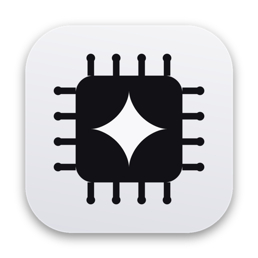
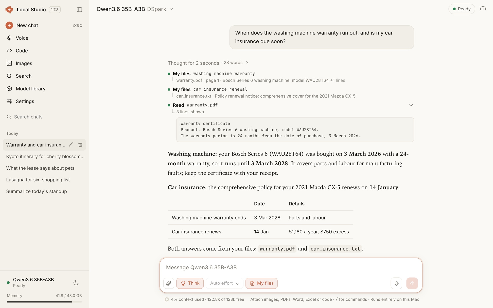

<h1 align="center">Local Studio</h1>

<b>A private AI studio that runs on your Mac.</b> 
Chat, code, talk, search your files and make images with open models. Your chats and files stay on this Mac.

<a href="https://github.com/vinoth12940/local-studio-releases/releases/latest"><b>⬇️ Download for Mac</b></a>
&nbsp;·&nbsp; <a href="https://vinoth12940.github.io/local-studio-releases/">Website</a>

## Install

1. Download the latest `Local-Studio-<version>.dmg` from [Releases](https://github.com/vinoth12940/local-studio-releases/releases/latest).
2. Open it and drag **Local Studio** to **Applications**.
3. Open Local Studio and click **Install** (about 3 GB, a few minutes).
4. Pick a model.

The DMG is signed with a Developer ID and notarized by Apple. Each release lists its SHA-256.

**You need:** Apple Silicon (M1 or newer), macOS 14 Sonoma or later, 16 GB of memory or more.

This repository holds downloads only. Questions and bug reports: open an [issue](https://github.com/vinoth12940/local-studio-releases/issues).
